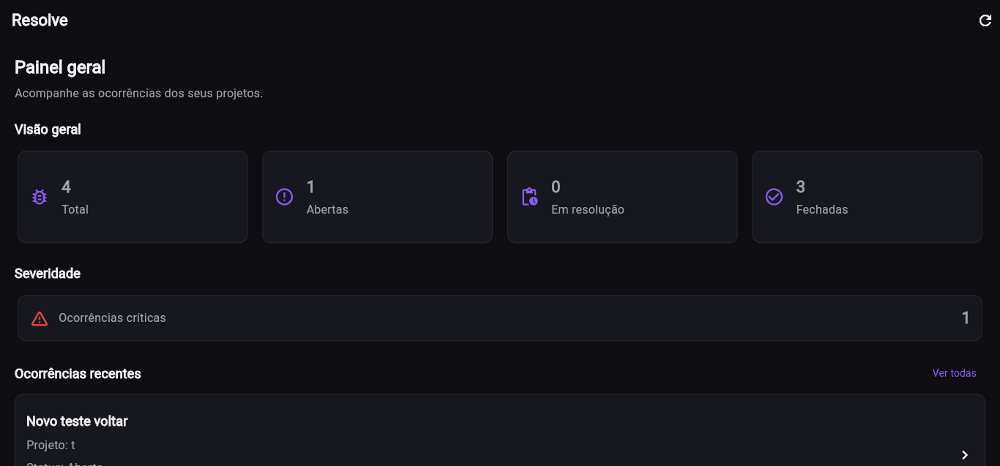
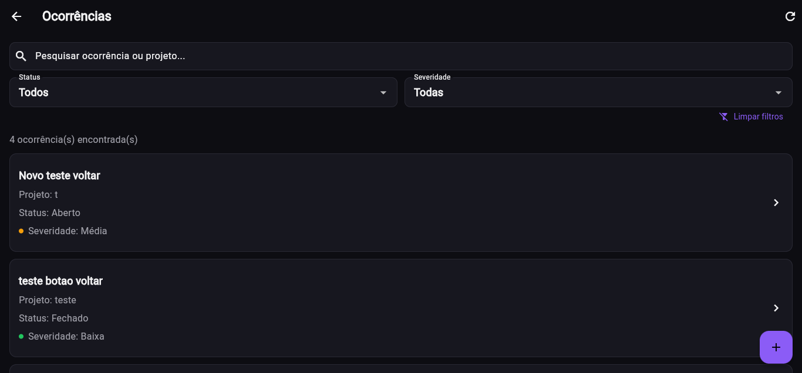
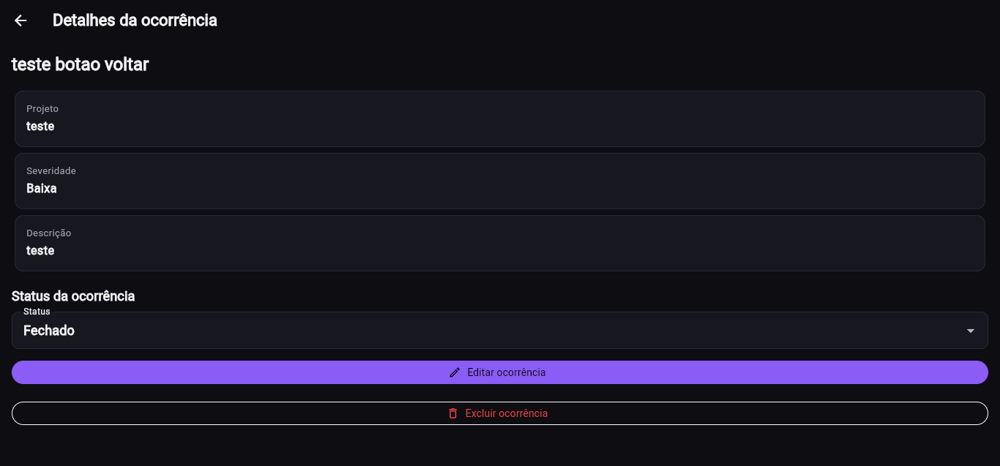
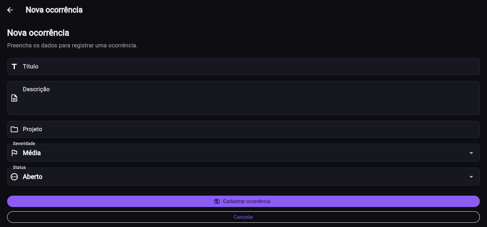

# Resolve

Aplicação web responsiva para gerenciamento de ocorrências e bugs em projetos de software. O Resolve permite registrar problemas, acompanhar status e severidade, consultar detalhes, editar informações e excluir ocorrências.

**Aplicação em produção:** https://resolve-mobile-sage.vercel.app  
**API em produção:** https://resolve-api-1evi.onrender.com  
**Repositório:** https://github.com/oliveiragabe/Resolve

## Informações acadêmicas

- **Aluno:** Gabriel
- **Disciplinas:** Programação para Dispositivos Móveis, Programação Orientada a Objetos para Web e Paradigmas de Linguagem de Programação
- **Back-end escolhido para o trabalho mobile:** Opção A — API Laravel
- **Aplicativo:** Flutter e Dart
- **Back-end:** Laravel e PHP
- **Banco de dados de produção:** PostgreSQL (Supabase)

## Sobre o projeto

O Resolve foi desenvolvido como trabalho final integrado das disciplinas de Programação para Dispositivos Móveis, Programação Orientada a Objetos para Web e Paradigmas de Linguagem de Programação.

A aplicação Flutter consome uma API REST desenvolvida em Laravel por meio de requisições HTTP e troca de dados em JSON. A API organiza as operações em Controller, Service e Repository, enquanto o aplicativo mobile separa modelos, serviços, telas, widgets e recursos compartilhados.

Em produção, o Flutter Web está hospedado na Vercel, a API Laravel no Render e o banco PostgreSQL no Supabase.

## Funcionalidades

- Cadastro de ocorrências.
- Listagem de ocorrências carregadas da API.
- Consulta dos detalhes de uma ocorrência.
- Edição de título, descrição, projeto, severidade e status.
- Exclusão de ocorrências.
- Atualização do status diretamente na tela de detalhes.
- Pesquisa por título ou projeto.
- Filtros por status e severidade.
- Dashboard com indicadores e ocorrências recentes.
- Validação dos formulários.
- Tratamento de carregamento, erros e lista vazia.

### Status disponíveis

- Aberto
- Em resolução
- Fechado

### Níveis de severidade

- Baixa
- Média
- Crítica

## Telas e rotas

| Tela | Rota | Descrição |
|---|---|---|
| Dashboard | `/` | Indicadores gerais e ocorrências recentes |
| Listagem de ocorrências | `/issues` | Lista, pesquisa e filtros |
| Nova ocorrência | `/issues/new` | Formulário de cadastro |
| Detalhes da ocorrência | `/issues/:id` | Consulta, alteração de status e exclusão |
| Editar ocorrência | `/issues/:id/edit` | Formulário de edição |

A navegação é gerenciada pelo pacote `go_router`, com nomes de rotas centralizados em `core/routes/app_routes.dart` e configuração em `core/routes/app_router.dart`.

## Tecnologias utilizadas

### Aplicativo Flutter

- **Flutter e Dart:** construção da interface e lógica do aplicativo.
- **go_router:** navegação e gerenciamento das rotas.
- **http:** comunicação com a API REST.
- **Material Design:** componentes visuais.
- **flutter_test:** testes automatizados de unidade e widgets.

### API Laravel

- **PHP e Laravel:** implementação da API.
- **Eloquent ORM:** persistência e consulta dos registros.
- **PostgreSQL:** banco de dados utilizado em produção.
- **API REST:** operações CRUD e respostas em JSON.

### Infraestrutura de produção

| Componente | Serviço |
|---|---|
| Aplicativo Flutter Web | Vercel |
| API Laravel | Render |
| Banco de dados PostgreSQL | Supabase |

## Arquitetura e organização

### Aplicativo Flutter

A estrutura segue a organização em camadas definida para a disciplina de Programação para Dispositivos Móveis:

```text
apps/mobile/lib/
├── main.dart
├── app.dart
├── core/
│   ├── constants/
│   ├── routes/
│   ├── theme/
│   └── utils/
├── models/
├── services/
├── screens/
└── widgets/
```

Responsabilidades das camadas:

- **Models:** representam as entidades e fazem a conversão dos dados JSON por meio de métodos como `fromJson` e `toJson`.
- **Services:** centralizam as requisições HTTP e retornam models para as telas.
- **Screens:** apresentam as funcionalidades e acessam os dados por meio dos services, sem realizar chamadas HTTP diretamente.
- **Widgets:** reúnem componentes reutilizáveis.
- **Core:** concentra constantes, rotas, tema, dimensões e validações.

### API Laravel

A API utiliza separação de responsabilidades em Controller, Service e Repository:

```text
apps/api/app/
├── Http/
│   ├── Controllers/
│   │   └── IssueController.php
│   ├── Services/
│   │   └── IssueService.php
│   └── Repositories/
│       └── IssueRepository.php
└── Models/
    └── Issue.php
```

Responsabilidades das camadas:

- **Models:** representam as entidades persistidas e definem os campos preenchíveis.
- **Controllers:** recebem as requisições HTTP, validam os dados de entrada e retornam respostas JSON com os códigos HTTP apropriados.
- **Services:** coordenam as operações da aplicação e delegam o acesso aos dados ao Repository.
- **Repositories:** concentram as operações de consulta, criação, atualização e exclusão no banco de dados.

Esse desenho reduz o acoplamento entre as responsabilidades e facilita a manutenção e reutilização do código.

## API REST

A API disponibiliza as operações CRUD para a entidade `issues`:

| Método | Endpoint | Operação |
|---|---|---|
| GET | `/api/issues` | Listar ocorrências |
| GET | `/api/issues/{id}` | Consultar uma ocorrência |
| POST | `/api/issues` | Criar ocorrência |
| PUT | `/api/issues/{id}` | Atualizar ocorrência |
| DELETE | `/api/issues/{id}` | Excluir ocorrência |

Os dados são enviados e recebidos em JSON.

### Campos da ocorrência

- `title`: título.
- `description`: descrição.
- `project`: projeto relacionado.
- `severity`: gravidade (`baixa`, `media` ou `critica`).
- `status`: situação (`aberto`, `em_resolucao` ou `fechado`).

## Como executar localmente

Pré-requisitos:

- Flutter SDK e Dart.
- PHP e Composer.
- Banco de dados compatível com a configuração do Laravel.

### 1. Clonar o repositório

```bash
git clone https://github.com/oliveiragabe/Resolve.git
cd Resolve
```

### 2. Configurar a API Laravel

Acesse a pasta da API:

```bash
cd tads-es-2026-poo-web/apps/api
composer install
cp .env.example .env
php artisan key:generate
```

Configure no arquivo `.env` a conexão com o banco de dados que será utilizado no ambiente local. Para utilizar SQLite, por exemplo:

```env
DB_CONNECTION=sqlite
```

Crie o arquivo do banco, caso ainda não exista, e execute as migrations:

```bash
touch database/database.sqlite
php artisan migrate
```

Inicie a API:

```bash
php artisan serve --host=0.0.0.0 --port=8000
```

A API ficará disponível em `http://localhost:8000`.

### 3. Configurar a URL da API no Flutter

No arquivo:

`tads-es-2026-poo-web/apps/mobile/lib/core/constants/api_constants.dart`

Configure `ApiConstants.baseUrl` com a URL base da API do seu ambiente. Para execução local, utilize:

```dart
static const String baseUrl = 'http://localhost:8000';
```

O endpoint `/api/issues` é acrescentado pela constante `ApiConstants.issues`.

Se estiver executando o Flutter em um dispositivo físico ou em outro ambiente, utilize um endereço de API acessível por esse dispositivo/ambiente.

### 4. Executar o aplicativo Flutter

Em outro terminal:

```bash
cd tads-es-2026-poo-web/apps/mobile
flutter pub get
flutter run -d chrome
```

Mantenha a API Laravel em execução enquanto utiliza o aplicativo.

## Testes e análise

Na pasta `tads-es-2026-poo-web/apps/mobile`, execute:

Formatar o código:

```bash
dart format .
```

Executar a análise estática:

```bash
flutter analyze
```

Executar os testes automatizados:

```bash
flutter test
```

A suíte contempla testes de unidade e de widgets para modelos, validações, serviços e telas. **Na última execução registrada durante o desenvolvimento, os 43 testes passaram.**

## Relação com os requisitos das disciplinas

### Programação para Dispositivos Móveis

| Requisito da atividade | Implementação no Resolve |
|---|---|
| Aplicativo em Flutter/Dart | Aplicativo desenvolvido em Flutter e Dart |
| Consumo de back-end real — Opção A | Consumo da API REST Laravel por HTTP |
| CRUD completo de uma entidade | Cadastro, listagem, consulta, edição e exclusão de ocorrências |
| Arquitetura em camadas | Separação em core, models, services, screens e widgets |
| Models com conversão JSON | `Issue.fromJson` e `Issue.toJson` |
| Navegação com go_router e rotas nomeadas | Rotas centralizadas em `core/routes/` |
| Mínimo de quatro telas com funções distintas | Dashboard, listagem, formulário e detalhes; cadastro e edição utilizam o formulário em contextos distintos |
| Programação assíncrona | Requisições HTTP com `async/await` e Futures |
| Estados de carregamento, erro e lista vazia | Tratamento nas telas que carregam dados da API |
| Validação centralizada | Validadores em `core/utils/` |
| Tema próprio | `ThemeData` centralizado em `core/theme/` |
| Testes | Testes automatizados de unidade e widgets |

### Paradigmas de Linguagem de Programação

| Aspecto avaliado | Implementação no Resolve |
|---|---|
| Arquitetura do sistema | Aplicativo e API organizados em camadas |
| Reutilização de funções e componentes | Widgets compartilhados e operações centralizadas nos services |
| Uso adequado da camada Services | `IssueService` no Flutter e `IssueService` no Laravel |
| Uso adequado da camada Repositories | `IssueRepository` concentra o acesso aos dados no Laravel |
| Separação de responsabilidades e boas práticas | Controller valida e responde HTTP; Service coordena; Repository acessa os dados; Model representa a entidade |

## Capturas de tela

### Dashboard



### Listagem de ocorrências



### Detalhes da ocorrência



### Cadastro de ocorrência



## Entrega acadêmica

- **Repositório:** https://github.com/oliveiragabe/Resolve
- **Aplicação publicada:** https://resolve-mobile-sage.vercel.app

## Observações

- Não publique arquivos `.env`, senhas, tokens ou credenciais de serviços.
- Para executar localmente, configure a URL da API e as variáveis de ambiente do Laravel para o seu próprio ambiente.
- A infraestrutura de produção utiliza variáveis de ambiente configuradas diretamente nos serviços de hospedagem.
